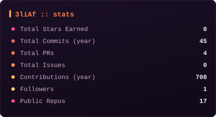
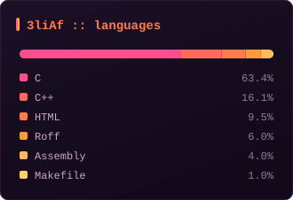

  

## `~/about`

**AI Engineer** · **Data Scientist** · Founder [@Astrameld](https://astrameld.com)  
M.Sc. Artificial Intelligence · Erlangen, Germany

I build AI systems that automate business workflows and turn messy operational data into decisions. My work spans **LLM agents, retrieval systems, forecasting and pricing models, and production-grade APIs**.

Currently reading for an **M.Sc. in Artificial Intelligence** in Germany while building **[Astrameld](https://astrameld.com)**, an AI automation agency.

## `~/featured`

- [**rag-eval-metrics**](https://github.com/3liAf/rag-eval-metrics) — Zero-dependency evaluation metrics (Hit Rate @ K, MRR, NDCG) for RAG retrieval benchmarking.
- [**prompt-telemetry-php**](https://github.com/3liAf/prompt-telemetry-php) — Zero-dependency PHP 8.4+ utility for calculating LLM token consumption, latency, and cost telemetry.
- [**ai-env-toolkit**](https://github.com/3liAf/ai-env-toolkit) — POSIX shell scripts for inspecting, auditing, and maintaining local AI developer environments and GPU memory.
- [**docker-agent-sandbox**](https://github.com/3liAf/docker-agent-sandbox) — Hardened Alpine-based execution container for evaluating untrusted LLM-generated code.
- [**awesome-nfc**](https://github.com/3liAf/awesome-nfc) — Curated NFC tools, hardware guides, and browser-based Web NFC workflows.

## `~/card`

  

Scouted on <strong><a href="https://gitfut.com/3liAf">GitFut</a></strong> · Challenge me to a duel at <a href="https://gitfut.com/3liAf/vs">gitfut.com/3liAf/vs</a>

## `~/stack`

**Core**

**AI Engineering**

**Backend & Data**

**Cloud & Delivery**

## `~/stats`

Regenerated daily by <a href="https://github.com/3liAf/3liAf/actions">GitHub Actions</a> — no third-party services.

